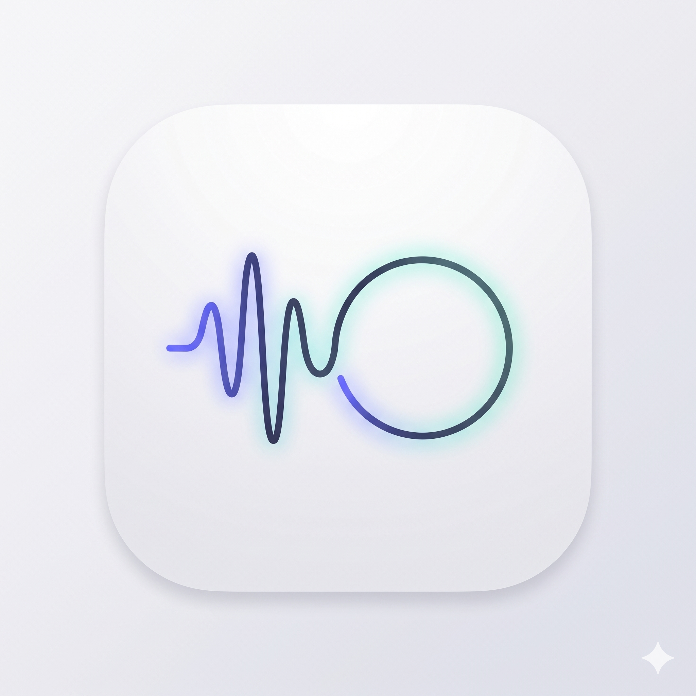
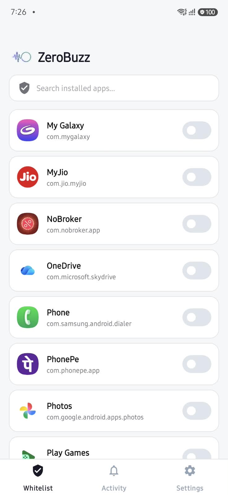
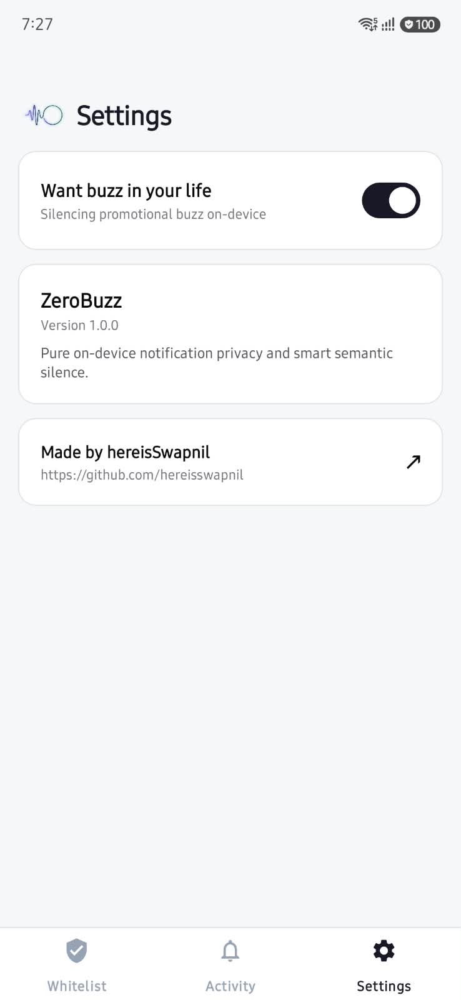
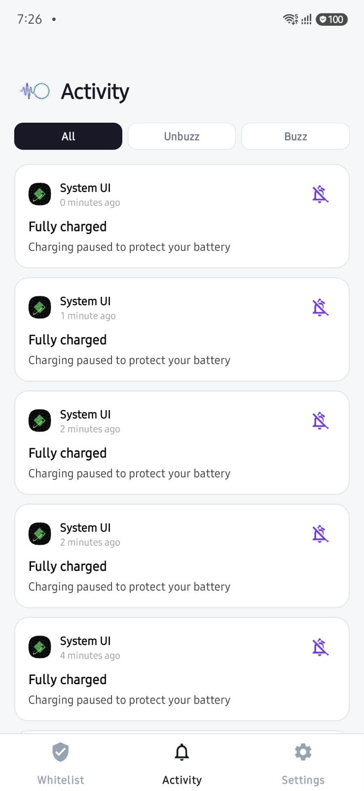

<p align="center">
  
</p>

<h1 align="center">ZeroBuzz</h1>

<p align="center">
  <strong>Pure on-device notification privacy and smart semantic silence.</strong><br>
  ZeroBuzz intercepts and silences promotional noise, marketing campaigns, and clickbait notifications in real time — with zero internet permissions, &lt;0.1ms latency, and 100% offline privacy.
</p>

<p align="center">
  <a href="LICENSE"></a>
  
  
  
  
</p>

## ✨ The Story Behind ZeroBuzz

Every single day, my phone was buzzing incessantly.

I would pick it up in a hurry expecting an urgent OTP, a bank transaction, an important message, or a cab arrival alert. Instead?
- *"Craving Biryani? Get 60% OFF right now!"* 🍕
- *"Pre-approved personal loan of ₹5,00,000 waiting for you!"* 💸
- *"Hurry! Flash sale ends in 14 minutes!"* ⚡
- *"Your cart misses you! Complete checkout now."* 🛒

Modern apps treat our notification shades like free billboard space. Every app feels entitled to buzz your pocket with manufactured urgency just to bump its daily active user metrics.

I tried turning off app notifications entirely, but then I missed real-time cab tracking, delivery partner calls, and flight updates. Android's native "Do Not Disturb" is a blunt hammer — it silences everything or nothing. And third-party notification managers were either bloated, battery hogs, or demanded full network access to analyze private notifications in the cloud.

I was completely fed up. I wanted my phone to be peaceful again without risking critical alerts, and without handing over my notification feed to remote servers.

So I built **ZeroBuzz**.

---

### What ZeroBuzz Does

**ZeroBuzz** is a lightweight, 100% on-device Android service powered by a subword semantic classifier. It automatically detects and silences commercial promotional spam in real time, while guaranteeing that your **OTPs, bank account debits/credits, cab tracking, delivery alerts, and personal messages** arrive untouched.

- 🔒 **Zero Internet Permission:** `android.permission.INTERNET` is not even requested in the manifest. Nothing ever leaves your phone.
- ⚡ **Sub-Millisecond Speed:** The native Kotlin engine evaluates notifications in under `0.1ms` with 0% battery impact.
- 🎯 **Ground-Truth Trained:** Built on Indian telecom regulatory standards (TRAI headers), public academic benchmarks, and personalized on-device feedback.

---

## 📦 Download & Quick Install

### 1. Download Pre-built APK
Grab the latest release APK directly from GitHub:

👉 **[Download Latest ZeroBuzz APK](https://github.com/hereisSwapnil/ZeroBuzz/releases/latest)**

### 2. Install on Your Phone (Android 8.0+)
1. Download the `.apk` file to your Android phone.
2. Tap to install (enable *"Install from unknown sources"* if prompted).
3. Open **ZeroBuzz** and grant **Notification Listener Permission** when prompted.
4. That's it! ZeroBuzz runs silently in the background.

---

## 📱 Screenshots

<p align="center">
  
  
  
</p>

---

## 🔥 Key Features

- 🛡️ **100% On-Device** — Zero internet permissions. Your data never leaves your phone.
- ⚡ **Sub-Millisecond** — Classifies notifications in under `0.1ms` with zero battery impact.
- 🎯 **Smart Safety** — OTPs, bank alerts, cab tracking, and deliveries are never silenced.
- 📋 **App Whitelist** — Instantly whitelist apps like WhatsApp or Slack for zero-delay passthrough.
- 📊 **Activity Feed** — Review blocked notifications and one-tap toggle `Buzz` / `Unbuzz`.
- 🔄 **Feedback Loop** — Sync corrections via USB, retrain, and hot-reload updated weights.
- 🎨 **Minimal UI** — Clean monochromatic design with adaptive theming.

---

## 🏗️ How It Works

```
Incoming Push Notification
         │
         ▼
[NotificationListenerService]
         │
         ├───► Is Package in Whitelist?
         │         ├── YES ──► Deliver Immediately (0ms delay, no logging)
         │         └── NO
         │              │
         │              ▼
         ├───► Is Engine Enabled? ("Want buzz in your life")
         │         ├── NO ──► Deliver Untouched
         │         └── YES
         │              │
         │              ▼
         ├───► [SemanticClassifier.classify()]
         │         │
         │         ├── 1. Hard Safety Rules (OTP, Bank Debit/Credit, Delivery, Meds) ──► DELIVER
         │         └── 2. Linear Subword Naive Bayes Score (Threshold: 0.50)
         │                   │
         │                   ├── Score >= 0.50 (Spam / Promo) ──► cancelNotification() [SILENCED]
         │                   └── Score < 0.50  (Essential)    ──► DELIVER
         │
         ▼
[Local Activity Log] ──► Inspect in App & Toggle Preferences Anytime
```

---

## 📊 Dataset & Ground-Truth Classification

ZeroBuzz does not rely on cloud LLMs for classification. Training corpora are compiled from deterministic ground-truth:

1. **[TRAI Telecom Regulatory Standards (TCCCPR)](https://trai.gov.in/notifications/press-releases/telecom-commercial-communications-customer-preference-regulations-2018):** In India, incoming SMS headers are strictly typed by telecom networks:
   - `-P` suffix (e.g., `AX-TNCARD-P`, `CP-TITNWO-P`): Mandatory **Commercial Promotional Marketing** $\rightarrow$ `Label 1`.
   - `-S` / `-T` / `-G` suffixes (e.g., `VM-KOTAKB-S`, `AX-HDFCBK-T`): Service, OTP, and Government alerts $\rightarrow$ `Label 0`.
2. **Public Academic & Benchmark Datasets:**
   - [UCI Machine Learning Repository: SMS Spam Collection](https://archive.ics.uci.edu/dataset/228/sms+spam+collection) (5,574 samples)
   - [Hugging Face: `alusci/sms-otp-spam-dataset`](https://huggingface.co/datasets/alusci/sms-otp-spam-dataset) (10,000 OTP & authentication samples)
   - [Hugging Face: `mshenoda/spam-messages`](https://huggingface.co/datasets/mshenoda/spam-messages) (50,000+ marketing and spam samples)
3. **Hard Mission-Critical Rules:** Regex shields guarantee that any notification with valid OTP codes, bank transaction amounts, or cab arrival status passes through untouched.

*(All datasets are downloaded locally on demand via `just download-data` and are never committed or pushed to Git).*

---

## 📜 License

Distributed under the **MIT License**. See [`LICENSE`](LICENSE) for more information.

---

<p align="center">
  Crafted with care by <strong><a href="https://github.com/hereisSwapnil">Swapnil</a></strong>
</p>
